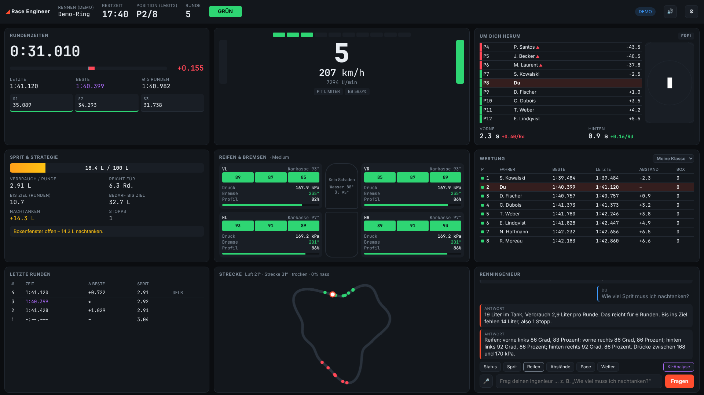

# LMU Race Engineer – KI-Renningenieur für Le Mans Ultimate

Ein Renningenieur mit Stimme und Dashboard für **Le Mans Ultimate**. Er liest die Telemetrie
live aus dem Spiel, sagt dir per Funk alles Wichtige an und beantwortet deine Fragen,
auf Wunsch mit **Claude (KI)**.



## Was er kann

| Bereich | Funktionen |
|---------|-----------|
| **Spotter** | „Auto links“, „Auto rechts“, „Drei breit“, „Frei“, dazu ein Radar im Dashboard |
| **Sprit & Strategie** | Verbrauch pro Runde (Schnitt der letzten 5 gültigen Runden), Reichweite in Runden, Bedarf bis ins Ziel (Zeit- und Rundenrennen), **wie viel nachtanken**, Anzahl Stopps, Boxenfenster, „Box, Box!“-Warnung |
| **Virtuelle Energie** | Stand, Verbrauch pro Runde und Reichweite (Hypercar/GT3 mit Energielimit, über die LMU-REST-API) |
| **Rundenzeiten** | Live-Delta zur Bestrunde, Sektorzeiten (lila/grün/gelb), Rundenzeit-Ansage, neue Bestzeit, Schnitt der letzten Runden |
| **Abstände** | Abstand nach vorne und hinten in deiner Klasse mit Trend („du holst 3 Zehntel pro Runde“), Relativ-Liste der Autos um dich herum |
| **Position** | Klassen- und Gesamtposition, Ansage bei Positionswechsel, komplette Wertung |
| **Multiklasse** | Warnung „Hypercar kommt von hinten“, langsamere Klasse voraus, blaue Flagge |
| **Flaggen** | Start, Gelb pro Sektor, Full Course Yellow / Safety Car, Grün, blaue Flagge, Strafen, letzte Runde, Zielflagge |
| **Reifen & Bremsen** | Temperaturen innen/mitte/außen, Karkasse, Druck, Verschleiß, Bremstemperaturen, Warnungen bei heiß/kalt/abgefahren, Reifenschaden |
| **Schaden & Technik** | Kontakt, Schaden, verlorene Teile, Wasser-/Öltemperatur, Pitlimiter-Erinnerung |
| **Wetter & Session** | Luft-/Streckentemperatur, Regen, Nässe, Restzeit-Ansagen (30/15/10/5/2/1 Min.) |
| **KI-Fragen** | „Wie viel muss ich nachtanken?“, „Wer ist hinter mir?“, „Wie sind meine Reifen?“ per Text oder **Sprache** |
| **KI-Rennanalyse** | Auswertung nach der Session durch Claude: Pace, Konstanz, Strategie, Tipps |
| **Fahrlinie & Kurven** | erkennt die Kurven automatisch und vergleicht jede Runde mit deiner Bestrunde: Zeitverlust pro Kurve, Bremspunkt, Kurvenspeed, Gaspunkt, Linie am Scheitelpunkt (innen/außen), theoretische Bestzeit, Tipp per Funk |
| **Streckenkarte** | wird aus deiner ersten Runde aufgezeichnet, mit allen Autos live und Kurvennummern |

Das Dashboard läuft im Browser: auf einem Zweitbildschirm, einem Tablet oder dem Handy.

---

## 1. Installation (einmalig)

1. **Python 3.11 oder neuer** installieren: <https://www.python.org/downloads/>
   → beim Installieren **„Add python.exe to PATH“** anhaken.
2. Im Ordner `race-engineer` doppelt auf **`start_demo.bat`** klicken.
   Beim ersten Start werden die Pakete installiert (ca. 1 Minute). Danach öffnet sich das Dashboard
   mit einem **simulierten Rennen**, damit du alles ohne Spiel ausprobieren kannst.
3. Fragt die Windows-Firewall nach, **„Zulassen“** wählen (nur nötig, wenn du Tablet oder Handy nutzen willst).

## 2. Le Mans Ultimate verbinden (einmalig)

LMU gibt seine Telemetrie über das **rFactor-2-Shared-Memory-Plugin** heraus. Das nutzen auch
CrewChief und SimHub. Ist eins davon bei dir schon eingerichtet, ist das Plugin bereits aktiv.

1. Prüfe, ob im Spielordner die Datei liegt:
   `…\steamapps\common\Le Mans Ultimate\Plugins\rFactor2SharedMemoryMapPlugin64.dll`
   Falls nicht: von <https://github.com/TheIronWolfModding/rF2SharedMemoryMapPlugin/releases>
   herunterladen und in den Ordner `Plugins` kopieren.
2. Öffne `…\Le Mans Ultimate\UserData\player\CustomPluginVariables.JSON` mit dem Editor und setze
   beim Plugin `" Enabled"` auf `1`:
   ```json
   "rFactor2SharedMemoryMapPlugin64.dll": {
     " Enabled": 1,
     ...
   }
   ```
   Die übrigen Werte im Eintrag lässt du, wie sie sind.
   (Steht der Eintrag noch nicht drin, starte LMU einmal mit der DLL im Plugins-Ordner, dann wird er angelegt.)
3. Ab jetzt **`start.bat`** benutzen. Starte LMU und fahr raus, dann erscheinen die Daten automatisch.

> Die **virtuelle Energie** liest der Ingenieur zusätzlich über die eingebaute Web-Schnittstelle von LMU
> (`localhost:6397`). Dafür musst du nichts einrichten. Liefert deine LMU-Version den Wert nicht, wird die
> Anzeige einfach ausgeblendet.

## 3. Sprachausgabe

- Standardmäßig spricht die **Windows-Stimme** am PC (geht über dein Headset ins Spiel-Audio).
- Für eine deutsche Stimme: Windows-Einstellungen → Zeit und Sprache → Sprache → **Deutsch** mit
  „Sprachausgabe“ installieren (Stimmen *Hedda*, *Katja* oder *Stefan*).
- Im Dashboard unter ⚙ kannst du umstellen: **PC**, **Dieses Gerät** (z. B. das Tablet spricht), **beides** oder **aus**,
  dazu Sprechtempo, Lautstärke und welche Ansagen du hören willst.
- Spotter-Ansagen unterbrechen alles andere. Veraltete Meldungen werden verworfen, damit nichts zu spät kommt.

## 4. Fragen stellen

- **Im Dashboard** tippen oder auf 🎤 klicken (bzw. **F2**) und sprechen. Die Spracheingabe funktioniert in Chrome und Edge.
- **Schnelltasten** im Dashboard: Status, Sprit, Reifen, Abstände, Pace, Wetter.
- **Tastenkürzel während der Fahrt** (funktionieren auch, wenn LMU im Vordergrund ist):

| Kürzel | Ansage |
|--------|--------|
| `Strg + Umschalt + 1` | Statusbericht (Position, Abstände, Sprit) |
| `Strg + Umschalt + 2` | Sprit & Strategie |
| `Strg + Umschalt + 3` | Reifen |
| `Strg + Umschalt + 4` | Abstände |
| `Strg + Umschalt + 5` | Fahrlinie: wo du am meisten Zeit verlierst |
| `Strg + Umschalt + 0` | Funk stumm / an |

> **Lenkrad-Tasten:** Leg einen Knopf in deiner Lenkrad-Software (z. B. Fanatec, Moza, Simucube) oder mit
> *JoyToKey* auf eines dieser Kürzel. Mit dem **PC-Deck** aus diesem Repo geht es auch: Taste mit der Aktion
> „Tastenkürzel“ anlegen, z. B. `ctrl+shift+2` für die Sprit-Ansage.
> Die Kürzel änderst du in `config.json` unter `"hotkeys"`.
> Läuft LMU als Administrator, muss auch `start.bat` als Administrator laufen, damit die Kürzel ankommen.

## 5. KI mit Claude (optional)

Ohne KI beantwortet der Ingenieur die typischen Fragen (Sprit, Reifen, Abstände, Position, Rundenzeiten,
Wetter, Schaden, Restzeit) mit eingebauten Antworten. Mit einem **Anthropic-API-Schlüssel** versteht er
beliebige Fragen („Lohnt sich ein Undercut auf Fischer?“, „Warum bin ich in Sektor 2 so langsam?“) und
erstellt die **KI-Rennanalyse**.

1. Schlüssel erstellen auf <https://platform.claude.com> (die API wird nach Verbrauch abgerechnet).
2. In `race-engineer\config.json` eintragen:
   ```json
   "anthropic_api_key": "sk-ant-...",
   ```
   oder die Umgebungsvariable `ANTHROPIC_API_KEY` setzen.
3. Neu starten. Im Dashboard steht jetzt „Claude aktiv“.

Unter ⚙ → **KI-Modus**: *Auto* (Standardfragen eingebaut und sofort, alles andere über Claude),
*Alles über Claude* oder *Nur eingebaut*. Verwendetes Modell: `ki_modell` in der `config.json`.
Der Schlüssel bleibt auf deinem PC. An Claude geht nur eine kompakte Zusammenfassung der Telemetrie zusammen mit deiner Frage.

## 6. Fahrlinie & Kurvenanalyse

Nach deiner ersten sauberen Runde (ohne Boxenstopp) erkennt der Ingenieur die Kurven der Strecke
und nimmt deine **Bestrunde als Referenz**. Jede weitere Runde wird Kurve für Kurve damit verglichen.
Wird eine Runde schneller, ist sie automatisch die neue Referenz.

| Wert | Bedeutung |
|------|-----------|
| **Zeit** | Gewinn/Verlust im Abschnitt *Bremspunkt dieser Kurve bis Bremspunkt der nächsten*. Damit zählt auch der Kurvenausgang (Speed auf der folgenden Geraden). Alle Abschnitte zusammen ergeben genau dein Runden-Delta. |
| **Bremse** | Wo du angefangen hast zu bremsen, verglichen mit der Bestrunde (früher/später in Metern) |
| **Min km/h** | Langsamster Punkt der Kurve (Scheitelpunkt-Speed) |
| **Gas** | Wo du wieder voll am Gas warst |
| **Scheitel** | Wie weit du am Scheitelpunkt innen oder außen von deiner Bestrunden-Linie warst |
| **Ø** | Durchschnitt der letzten Runden: zeigt Kurven, in denen du *dauerhaft* Zeit liegen lässt |
| **Theoretische Bestzeit** | Summe deiner besten Abschnitte aus allen Runden |

- **Funk:** Nach jeder Runde sagt er dir die Kurve mit dem größten Zeitverlust samt Grund, z. B.
  *„Kurve 4: 3 Zehntel verloren, 15 Meter zu früh gebremst.“* (abschaltbar unter ⚙)
- **Nachfragen:** „Wo verliere ich Zeit?“, „Wie war mein Bremspunkt in Kurve 3?“, Taste **Fahrlinie** oder `Strg + Umschalt + 5`.
  Mit Claude bekommst du auch ausführliche Tipps, weil die KI die komplette Kurvenauswertung sieht.
- **Dashboard → Karte, Reiter „Kurven“:** Tabelle aller Kurven. Ein Klick auf eine Kurve öffnet **„Vergleich“**:
  deine Linie gegenüber der Bestrunde in der Draufsicht (Abweichung 3× vergrößert, damit man die Meter sieht),
  dazu Speed, Gas und Bremse über die Strecke.

> Gemessen wird deine eigene Linie gegen deine eigene Bestrunde. Eine „Ideallinie“ der Strecke liefert LMU nicht.
> Die Linienposition kommt aus den Weltkoordinaten des Autos und ist auf etwa einen halben Meter genau.

## 7. Dashboard auf Tablet oder Handy

Im Programmfenster steht eine Adresse wie `http://192.168.178.20:8770/?t=…`. Die im Browser des Tablets
oder Handys öffnen (gleiches WLAN). Der Token in der Adresse schützt vor fremden Zugriffen. Am PC selbst
reicht `http://127.0.0.1:8770`.

## Einstellungen (`config.json`)

| Schlüssel | Bedeutung |
|-----------|-----------|
| `quelle` | `auto` / `lmu` / `demo` |
| `sprit_reserve_runden` | Sicherheitsreserve bei der Sprit-Hochrechnung (Standard 0,5 Runden) |
| `abstand_alle_runden` | Wie oft Abstände angesagt werden |
| `rundenzeit_jede_runde` | Rundenzeit nach jeder Runde ansagen |
| `reifen_heiss` / `reifen_kalt` | Grenzwerte für Reifenwarnungen in °C |
| `bremse_heiss`, `wasser_max` | Grenzwerte für Bremsen und Kühlwasser |
| `spotter_seiten_tauschen` | Falls der Spotter links und rechts vertauscht |
| `fahrlinie_tipps` | Nach jeder Runde den größten Zeitverlust ansagen |
| `stimme` | Teil des Stimmennamens, z. B. `"Katja"` |
| `ansagen` | Ansage-Kategorien einzeln an/aus |
| `demo_zeitraffer` | Geschwindigkeit des Demo-Rennens |

## Probleme?

| Problem | Lösung |
|---------|--------|
| „Warte auf Le Mans Ultimate …“ | Plugin aktiviert (Schritt 2)? Bist du auf der Strecke (nicht nur im Menü)? |
| Keine Stimme | Lautsprecher-Symbol im Dashboard prüfen (🔇 = stumm). Unter ⚙ Sprachausgabe auf „PC“ stellen. |
| Englische Stimme | Deutsche Sprachausgabe in Windows installieren (siehe 3.) |
| Spotter vertauscht links/rechts | ⚙ → „Spotter: links/rechts tauschen“ |
| Tastenkürzel gehen nicht | `start.bat` als Administrator starten |
| KI antwortet nicht | Schlüssel in `config.json` richtig? Internetverbindung? |

## Dateien

```
race-engineer/
  start.bat          Startet den Renningenieur (installiert beim 1. Mal alles)
  start_demo.bat     Startet mit simuliertem Rennen (ohne Spiel)
  main.py            Server, Hauptschleife, Tastenkürzel
  lmu_shm.py         Telemetrie aus LMU (rF2-Shared-Memory)
  lmu_rest.py        Virtuelle Energie über die LMU-REST-API
  engineer.py        Auswertung & Ansagen (Sprit, Zeiten, Abstände, Flaggen, Reifen …)
  linecoach.py       Fahrlinie & Kurvenanalyse (Vergleich mit der Bestrunde)
  spotter.py         Spotter & Radar
  voice.py           Sprachausgabe (Windows-Stimme)
  assistant.py       Fragen beantworten (eingebaut + Claude)
  demo_source.py     Simuliertes Multiklassen-Rennen
  web/               Dashboard (HTML/CSS/JS)
```
